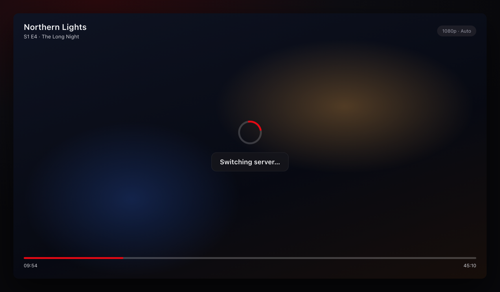
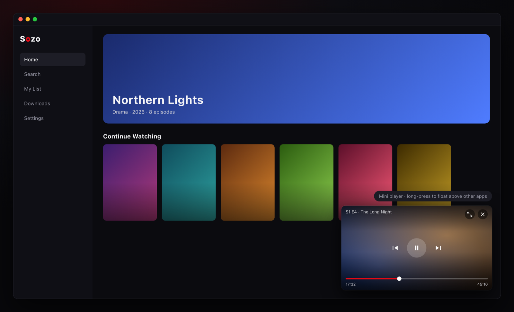
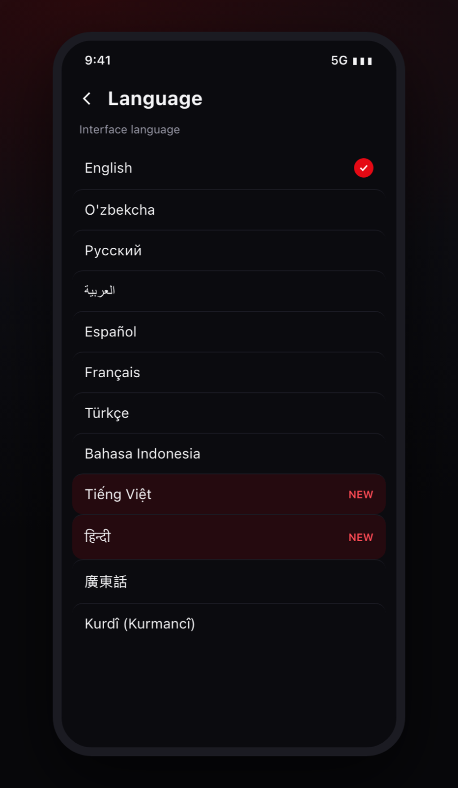
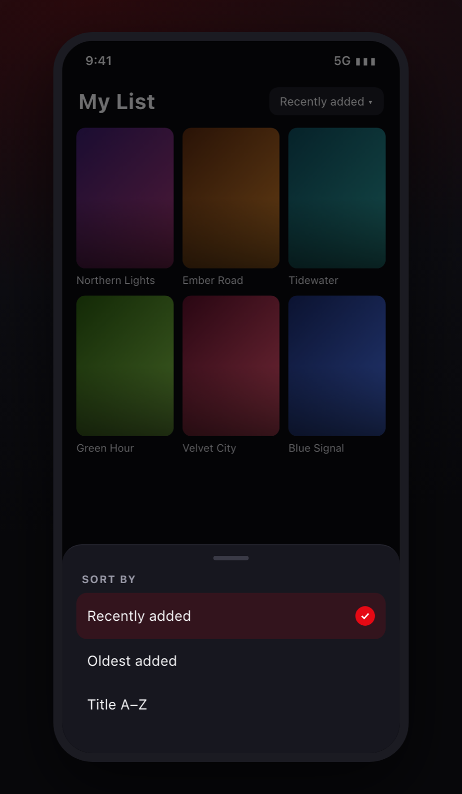

<!-- banner
line1: Playback that recovers,
line2: downloads that finish.
chips: Server switching | Corner player | Downloads | 16 languages
-->
<p align="center">
  <b>Sozo v3.2.1 is a patch release that fixes what you reported after v3.2.0.</b><br/>
  Videos no longer load forever, dropped connections recover, and more downloads work.<br/>
  It also adds a corner player on desktop, Vietnamese and Hindi, and sorting in My List.
</p>

<p align="center">
  <a href="#-download"></a>
  <a href="https://telegram.me/sozoapp"></a>
  <a href="https://discord.gg/n22URhYvMR"></a>
  <a href="https://github.com/professorDeveloper/sozo"></a>
</p>

---

## ▶️ Playback that recovers

| | |
|---|---|
| ⏱️ **No more endless "Video loading"** | A server now has about 25 seconds to start (about 35 for streams found inside a web page, about 90 for torrents). After that, the player moves to the next server. On Android, if the main player hands a stream to the system player, that player gets its own time. If the servers it tries all fail, it tells you. |
| 🔌 **Dropped connections** | After "Connection reset by peer", the player reconnects and carries on from the same position. A file cut short by the network now reconnects too, instead of stopping silently. You see an error only if that fails. |
| 🪜 **More servers get tried** | Many sources played the first server and then showed an error, with the others untried. They now try other servers, and your remembered quality is used. |
| 🎯 **1080p means 1080p** | On Android's system player, a quality you pick stays locked instead of starting at the lowest one. Auto now shows plain "Auto" instead of the size it started at. |
| 🎞️ **Video the player can't decode** | On Android, Sozo now switches to the system player when its main player can't open a video's codec. A single bad audio or video packet no longer stops playback with an error. |
| 🌑 **Black picture** | On Android, a video no longer stays black until your first seek. If the main player can't show a picture, Sozo switches to the system player. |
| 🐧 **Linux: a possible fix for a solid blue picture** | On one laptop with an RTX 4060, every video showed solid blue while the sound and timer kept running. Sozo now copies decoded frames through system memory on Linux. This uses more CPU. It has not been tested on Linux yet, so please tell us if your picture is still blue. |
| 🖼️ **Seek previews** | Frames should now arrive on slow hosts, a frame still loading when you lift your finger should be kept for the next drag, and a dead host should no longer leave a skeleton forever. The Android changes have not been tested on a device yet. The card now reads `00:49 / 02:07`. |

<p align="center"></p>

---

## 🖥️ Corner player on desktop

<p align="center"></p>

On Windows, macOS and Linux, press **I** or the mini player button to dock the video in a corner of the app. It keeps playing while you move around Home, Search, detail pages and settings. The video does not reload.

- **Move and resize it.** Drag it and it snaps to the nearest corner. Drag an inner edge to resize it. Sozo remembers the corner and the width.
- **Hover controls.** Close, back to the full player, previous and next episode, play and pause, 10-second steps when there is room, and a timeline.
- **The keyboard stays with your page.** Click the corner player to give it the keyboard. Esc or a click elsewhere gives it back without closing the video.
- **Above other apps.** Press **Shift+I** or long-press the button for a small always-on-top window. If you switch to another app while a video is playing, Sozo now shrinks to this window by itself. On macOS it also appears on every Space and beside full-screen apps.

---

## ⬇️ Downloads

> **If a download failed with "The source sent a web page instead of the video", delete it and download it again on v3.2.1.** A failed download keeps its old address, so retrying it may not help.

- **Fewer false "web page" errors.** Some hosts label real video as a web page. Sozo now checks the first bytes of the file, and refuses only real web pages.
- **Downloads ask for a file the way the player does.** Some hosts refused downloads of an episode that played fine.
- **One bad mirror no longer fails the episode.** It fails only if every mirror serves a page. Otherwise, the bad ones are left out of the choices.
- **Android: Save to Downloads now writes the video of an HLS download.** It used to save only a small playlist file. The parts are now joined into one `.ts` or `.mp4` file. Downloads with a separate audio track or SAMPLE-AES encryption are refused with a reason.

---

## ✨ Added

<p align="center"> </p>

- 🌍 **Vietnamese and Hindi**, so Sozo now has 16 languages. Subtitles in these languages are found by their labels and offered as translation targets. Both translations are machine-written and no native speaker has read them yet, so corrections are welcome.
- 📋 **Sort My List** by recently added, oldest added or title. Sozo remembers your choice on the device.
- 🔀 **Auto in "Try another source".** Sozo goes through the matches it trusts and opens the first one that can play the title.
- 📺 **One season at a time.** Sources that list every season together, such as CloudStream plugins, now get season chips, and episodes show as `S2 E1`. Seasons no longer sort into each other.
- 🎬 **Relations for films and series.** A title that isn't anime now shows the rest of its film series and TMDB's recommendations. AniList results appear only when the title really matches.
- 🔎 **Pinch zoom in the continuous manga reader.** Before, only the paged mode could zoom.
- 🚫 **Spliced-in ads.** A source can now mark ad segments in a stream, and the player leaves them out.
- 💬 **Burned-in subtitles.** A source can now say which language is already in the picture, and auto-translate won't draw a second line over it.
- 🍎 **iPhone player.** Clear glass under the controls and the system spinner when a video stalls. On all phones, locking or unlocking gives a firm tap and a double-tap seek gives a tick.

<p align="center"></p>

<details>
<summary><b>🔧 Other fixes</b></summary>

- **Windows:** turning on Anime4K no longer gives a black screen with a playback error.
- **Arabic:** tapping a tab in the bottom bar opened the mirror-image tab. It now opens the one you tapped.
- **Sources with no video for a title.** When a source moved a title to its own app or has no player, Sozo says so in your language. After that first try, Play is replaced by a way to find the title on another source. If a series was opened as a film, Sozo opens its episode list when the source gave one.
- **Fairer "Down" badges.** A source that runs on your phone no longer shows as Down only because our server timed out or couldn't reach its site. Long-press its row to check from your device. An empty catalogue now counts as a problem.
- **"Hide down sources"** now shows the number it really hides, and the quick-switch sheet uses the same health rules as the Sources screen.
- **Source check:** the message and the Hide button had swapped text in every language.
- **CloudStream:** search now works for plugins that only have paged search, such as MovieBox.
- **Streams stored inside image files** now play through the built-in proxy, and the proxy answers range requests the way players expect.
- **Subtitles:** you now get a message when a translation stops part way.
- **Subtitles:** a track in your subtitle language now starts ahead of the source's default, and one-tap translate uses a human subtitle in that language when there is one.
- **Long Vietnamese titles** keep their tone marks, and Hindi gets the same extra line height.
- **My List:** a catalogue title shows its name, not `cat:anilist`.
- **Support:** a follow-up on a ticket that had diagnostics now sends a newer report.
- **Corner player:** signing out or switching profile closes it first, so your last history save lands in the right account.

</details>

---

## ⬇ Download

<!-- downloads -->

<details>
<summary>🍎 macOS says the app is "damaged" or won't open</summary>

The DMG isn't signed with an Apple certificate. Run this once in Terminal:

```
xattr -dr com.apple.quarantine /Applications/Sozo.app
```

Or in Applications, right-click Sozo.app → **Open** → **Open**.
</details>

---

## 💬 Join the community

<p align="center">
  <a href="https://telegram.me/sozoapp"></a>
  <a href="https://discord.gg/n22URhYvMR"></a>
  <a href="https://sozo.azamov.me"></a>
  <a href="https://t.me/ackles"></a>
  <a href="https://www.buymeacoffee.com/chihaku"></a>
</p>

- 📣 **Telegram**: [@sozoapp](https://telegram.me/sozoapp) for new versions and announcements first.
- 🎧 **Discord**: [discord.gg/n22URhYvMR](https://discord.gg/n22URhYvMR) to suggest ideas and report bugs.
- 🛟 **In the app**: Profile → **Help & Support**. Many of these fixes started as tickets there.
- 🐛 **On GitHub**: [a source isn't working](https://github.com/professorDeveloper/sozo/issues/new?template=source_not_working.yml) · [bug report](https://github.com/professorDeveloper/sozo/issues/new?template=bug_report.yml) · [feature request](https://github.com/professorDeveloper/sozo/issues/new?template=feature_request.yml)
- ⭐ **If Sozo is useful to you, [star the repo](https://github.com/professorDeveloper/sozo)**.

<details>
<summary>🇺🇿 <b>O'zbekcha qisqacha</b></summary>

**Sozo v3.2.1: v3.2.0 dan keyin bildirilgan muammolar tuzatildi.**

- ▶️ **Pleer.** Endi "Video loading" cheksiz turmaydi: server taxminan 25 soniyada ochilmasa (torrent uchun taxminan 90 soniya), pleer keyingi serverga o'tadi. Aloqa uzilsa, video o'sha joyidan davom etadi.
- ⬇️ **Yuklab olish.** Noto'g'ri "web page" xatolari tuzatildi. **Avval xato bergan yuklamani o'chirib, v3.2.1 da qaytadan yuklab oling.** Android'da *Save to Downloads* endi HLS yuklamaning o'zini video fayl qilib saqlaydi.
- 🖥️ **Desktop.** Yangi burchak pleeri: **I** tugmasini bosing, video ilova burchagida davom etadi, siz esa boshqa sahifalarga o'tasiz. **Shift+I** boshqa ilovalar ustida turadigan kichik oynani ochadi.
- 🌍 **Vyetnam va hind tillari** qo'shildi, jami 16 ta til. Bu ikki tarjima mashinada qilingan.
- ✨ **Yangi.** My List'ni saralash, *Try another source* ichida **Auto**, CloudStream seriallari uchun fasllar bo'yicha ko'rinish, film va seriallar uchun Relations, manga reader'ning uzluksiz rejimida pinch zoom.
- 🔧 **Tuzatildi.** Windows'da Anime4K qora ekrani, arab tilida pastki panel, "Down" belgilari va boshqalar.

Yangiliklar: [@sozoapp](https://telegram.me/sozoapp) · Fikr va xatolar: [Discord](https://discord.gg/n22URhYvMR)
</details>

<sub>Full list of changes: <a href="https://github.com/professorDeveloper/sozo/compare/v3.2.0...v3.2.1">v3.2.0...v3.2.1</a></sub>
